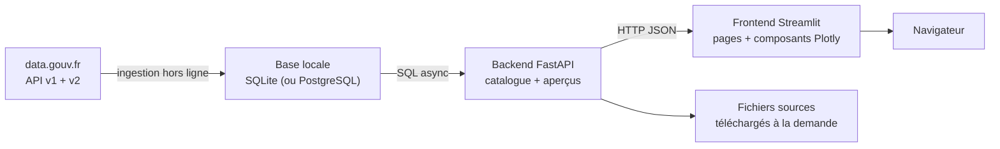

# 🇫🇷 DataFrance Explorer

Prototype d'explorateur des données publiques françaises : **backend FastAPI** qui
sert un catalogue [data.gouv.fr](https://www.data.gouv.fr) **ingéré dans une base
locale** (SQLite par défaut), et **frontend Streamlit** pour rechercher,
prévisualiser et visualiser les jeux de données.

> Le projet a d'abord servi de bac à sable FastAPI/Streamlit branché directement sur
> l'API officielle. Il fonctionne désormais comme une petite application autonome :
> une ingestion hors ligne remplit la base, puis l'API ne dépend plus du réseau
> pour répondre. La structure reste volontairement modulaire pour être enrichie
> facilement (nouvelles pages, nouveaux endpoints, nouveaux graphiques).

### Pourquoi une base locale plutôt que l'API officielle à l'exécution ?

- **Latence prévisible** : les requêtes SQL locales répondent en quelques
  millisecondes, sans attendre un service distant ni subir ses ralentissements.
- **Pas de plafond d'affichage** : l'API officielle v2 limite l'exploration à
  10 000 résultats ; la base locale renvoie un total exact et pagine librement.
- **Disponibilité** : le site continue de fonctionner si data.gouv.fr est
  momentanément indisponible ou si la machine n'a pas Internet après l'ingestion.
- **Pas de rate limiting** : une recherche en direct peut interroger le backend à
  chaque frappe sans risquer de se faire limiter par l'API amont.
- **Tests et développement déterministes** : les données ne changent pas entre deux
  appels, ce qui rend les captures, les tests et le débogage reproductibles.
- **Requêtes enrichies** : recherche accent-insensible, facettes et jointures sont
  calculées côté base, sans multiplier les appels réseau.

L'ingestion reste la seule étape qui contacte data.gouv.fr. Pour rafraîchir les
données, on relance `python -m app.ingest` (voir plus bas).

### Pourquoi pas Redis pour le moment ?

Redis serait utile pour partager un cache entre plusieurs workers ou plusieurs
machines. Ce n'est pas le besoin actuel :

- un seul processus FastAPI et une base SQLite suffisent à ce prototype ;
- ajouter Redis maintenant **masquerait** les vrais goulets d'étranglement des
  requêtes SQL au lieu de les mesurer ;
- cela ajouterait un service, un volume et une dépendance réseau à exploiter ;
- le cache TTL en mémoire du processus est suffisant pour amortir les aperçus de
  fichiers et les téléchargements répétés.

Redis pourra revenir plus tard si le déploiement passe à plusieurs workers ou si
les mesures montrent un besoin réel de cache partagé. Le code actuel n'en dépend
pas et `redis` n'est plus dans les dépendances.

---

## ✨ Fonctionnalités

- **Tableau de bord** : volumes globaux (jeux de données, organisations,
  réutilisations, services), répartition par famille de formats, type de
  producteur, licence et thématique.
- **Recherche en direct** : les résultats se mettent à jour pendant la frappe
  (composant `streamlit-searchbox`, suggestions + debounce) — pas besoin d'appuyer
  sur Entrée. Recherche accent-insensible, filtres famille de formats, producteur
  et licence, tri et pagination. Le total vient de la base locale : pas de plafond
  à 10 000 résultats, et la pagination est exacte.
- **Fiche jeu de données** : description, organisation, métriques, tags,
  ressources et liens officiels. Un lien **« Lire plus »** déplie le texte
  intégral des descriptions, dans les cartes comme dans les fiches.
- **Aperçu tabulaire** : lecture CSV / TSV / JSON / GeoJSON / Excel / Parquet,
  tableau interactif, export CSV. Les fichiers **Parquet pré-calculés par
  data.gouv.fr** sont utilisés en priorité.
- **Filtres locaux** : filtrer les lignes par plage numérique, période ou valeurs
  catégorielles, puis explorer les graphiques et corrélations sur le sous-ensemble.
- **Carte interactive** : onglet **🗺️ Carte** de la page *Visualiser*. Détection
  automatique des colonnes latitude/longitude, prise en charge des ressources
  **GeoJSON** (carte choroplèthe) et affichage sur fond OpenStreetMap.
  Un bouton de démonstration charge le jeu de données des gares ferroviaires.
- **Comparaison** : page **Comparer** pour rapprocher deux jeux de données —
  métadonnées, schémas, colonnes communes, distributions numériques et
  répartitions catégorielles.
- **Liens partageables** : la page *Visualiser* encode le jeu de données, le
  fichier et les filtres actifs dans l'URL, avec un lien prêt à copier.
- **Graphiques automatiques** : distributions numériques, répartitions
  catégorielles, séries temporelles, nuages de points, corrélations.
- **Profil statistique** : valeurs manquantes, unicité, min/moyenne/médiane/max,
  valeurs fréquentes.
- **Corrélations lisibles** : classement des paires les plus liées, matrice annotée,
  nuage de points avec droite de tendance, R² et interprétation en français.
- **Annuaire des organisations** avec leurs derniers jeux de données.
- **Cache TTL en mémoire** (sans Redis) et déploiement **Docker Compose** (API + UI
  + volume SQLite).
- **Ingestion reproductible** : un instantané du catalogue data.gouv.fr est chargé
  dans SQLite, puis l'API travaille hors ligne.
- **Header / footer** et charte graphique commune (bleu Marianne).

---

## 🧱 Architecture



L'ingestion (`app.ingest`) est la **seule** étape qui interroge data.gouv.fr pour
les métadonnées. Le backend lit ensuite la base locale ; il ne télécharge des
fichiers que lorsqu'un utilisateur demande un aperçu, un profil ou une carte.

```
.
├── backend/
│   ├── app/
│   │   ├── main.py              # application FastAPI, CORS, erreurs, health
│   │   ├── config.py            # réglages (préfixe DFE_)
│   │   ├── database.py          # moteur async SQLAlchemy + init SQLite
│   │   ├── models.py            # tables : organisations, datasets, ressources…
│   │   ├── ingest.py            # CLI d'ingestion data.gouv.fr -> base locale
│   │   ├── schemas.py           # modèles Pydantic exposés
│   │   ├── api/
│   │   │   ├── deps.py
│   │   │   └── routes/
│   │   │       ├── search.py        # /api/search/*
│   │   │       ├── datasets.py      # /api/datasets/*
│   │   │       ├── organizations.py # /api/organizations/*
│   │   │       └── overview.py      # /api/stats/overview
│   │   └── services/
│   │       ├── catalog.py       # requêtes SQL du catalogue local
│   │       ├── datagouv.py      # client API utilisé par l'ingestion
│   │       ├── tabular.py       # lecture fichiers, aperçu, profil, GeoJSON
│   │       └── cache.py         # cache TTL en mémoire (pas de Redis)
│   ├── Dockerfile
│   ├── requirements.txt
│   └── .env.example
├── frontend/
│   ├── app.py                   # point d'entrée Streamlit + navigation
│   ├── api_client.py            # appels HTTP vers le backend
│   ├── navigation.py            # navigation différée entre pages
│   ├── url_state.py             # partage de vues par URL
│   ├── Dockerfile
│   ├── styles.py                # CSS / charte graphique
│   ├── components/
│   │   ├── header.py            # header, footer, statut API
│   │   ├── cards.py             # cartes dataset / organisation / KPI
│   │   ├── charts.py            # graphiques Plotly + auto-génération
│   │   └── formatting.py        # formats français (nombres, dates…)
│   ├── views/
│   │   ├── dashboard.py
│   │   ├── explore.py
│   │   ├── visualize.py
│   │   ├── compare.py
│   │   ├── organizations.py
│   │   └── about.py
│   ├── .streamlit/config.toml
│   └── requirements.txt
├── scripts/
│   ├── setup.ps1
│   ├── run_backend.ps1
│   ├── run_frontend.ps1
│   └── smoke_test.py
├── docker-compose.yml
├── requirements.txt
└── README.md
```

### Base de données

L'ingestion crée les tables suivantes :

| Table | Contenu |
|---|---|
| `organizations` | producteurs, logo, badges, compteurs, description |
| `datasets` | métadonnées, texte de recherche normalisé, licence, métriques, période et zone |
| `resources` | fichiers d'un jeu de données (URL, format, taille, URL Parquet) |
| `dataset_formats` | formats normalisés + famille (`tabular`, `geographical`, `document`…) |
| `dataset_tags` | thématiques indexées pour les filtres |
| `site_stats` | compteurs globaux (réutilisations, services) |
| `ingestion_runs` | journal des ingestions (statut, durée, volumes, erreur) |

L'ingestion est un **remplacement complet** : elle vide les tables du catalogue
puis insère l'instantané dans une seule transaction. Si le réseau ou l'API échoue
en cours de route, la transaction est annulée et l'ancien catalogue reste lisible.
Le journal `ingestion_runs` conserve la trace de la tentative.

Le fichier `datafrance.db` est ignoré par Git : chaque environnement crée le sien
avec la commande d'ingestion.

---

## 🚀 Démarrage rapide (Windows / PowerShell)

Python **3.11** est recommandé (roues binaires pandas / pyarrow disponibles).

```powershell
# 1. Environnement virtuel
py -3.11 -m venv .venv
.\.venv\Scripts\Activate.ps1

# 2. Dépendances
pip install -r backend\requirements.txt -r frontend\requirements.txt
```

### Ingestion initiale (obligatoire une fois)

```powershell
cd backend
python -m app.ingest              # catalogue complet (~75 000 datasets)
# ou un échantillon rapide pour tester :
python -m app.ingest --limit 2000
```

La base est créée dans `backend/datafrance.db` par défaut (`DFE_DATABASE_URL`).
L'ingestion remplace entièrement le catalogue précédent dans une transaction :
en cas d'échec, l'ancien contenu reste intact. Comptez environ 10 minutes pour le
catalogue complet selon la connexion ; la commande affiche sa progression page
par page. Un `--limit 2000` suffit pour développer et tester l'interface.

### Terminal 1 — backend FastAPI

```powershell
cd backend
uvicorn app.main:app --reload --port 8000
```

- API : <http://127.0.0.1:8000>
- Documentation interactive : <http://127.0.0.1:8000/docs>

### Terminal 2 — frontend Streamlit

```powershell
cd frontend
$env:API_URL = "http://127.0.0.1:8000"   # optionnel, c'est la valeur par défaut
streamlit run app.py
```

- Application : <http://127.0.0.1:8501>

### Ou en une commande

```powershell
.\scripts\setup.ps1     # une seule fois
.\scripts\run_backend.ps1
.\scripts\run_frontend.ps1
```

> `start.ps1` peut aussi ouvrir les deux terminaux automatiquement.

### Vérifier le backend

```powershell
python scripts\smoke_test.py
```

Le script vérifie la santé du service, les statistiques, la recherche, le détail
d'un jeu de données, l'aperçu, le profil et les organisations. Si le catalogue
est vide, lancez d'abord l'ingestion : l'API renvoie alors un message explicite
(HTTP 503) au lieu de résultats vides.

---

## 🔌 Endpoints du backend

| Méthode | Route | Description |
|---|---|---|
| `GET` | `/api/health` | état du service, taille du catalogue et dernière ingestion |
| `GET` | `/api/stats/overview` | totaux, facettes, derniers jeux de données |
| `GET` | `/api/search/datasets` | recherche locale (`q`, `page`, `page_size`, `sort`, filtres) |
| `GET` | `/api/search/organizations` | recherche d'organisations |
| `GET` | `/api/datasets/{id}` | fiche complète + ressources |
| `GET` | `/api/datasets/{id}/preview` | aperçu d'une ressource (`resource_id`, `limit`) |
| `GET` | `/api/datasets/{id}/profile` | profil statistique (`resource_id`, `limit`) |
| `GET` | `/api/datasets/{id}/geo` | FeatureCollection GeoJSON allégée pour la carte (`resource_id`, `limit`) |
| `GET` | `/api/organizations/{id}` | fiche organisation + derniers datasets |

`page_size` est plafonné à **100** par requête. Le total et le nombre de pages
sont calculés sur la base locale, sans plafond artificiel.

Exemples :

```bash
curl "http://127.0.0.1:8000/api/search/datasets?q=transport&page_size=5"
curl "http://127.0.0.1:8000/api/datasets/<id>"                 # fiche + ressources
curl "http://127.0.0.1:8000/api/datasets/<id>/preview?limit=20"  # aperçu tabulaire
```

---

## ⚙️ Configuration

Copiez `backend/.env.example` vers `backend/.env` et ajustez si besoin.

| Variable | Défaut | Rôle |
|---|---|---|
| `DFE_DATABASE_URL` | `sqlite+aiosqlite:///./datafrance.db` | base locale ; PostgreSQL possible via `postgresql+asyncpg://…` (installer `asyncpg`) |
| `DFE_DATAGOUV_API_BASE` | `https://www.data.gouv.fr/api` | API amont, **utilisée uniquement par l'ingestion** |
| `DFE_HTTP_TIMEOUT` | `20` | timeout HTTP de l'ingestion et des téléchargements |
| `DFE_CACHE_TTL` | `300` | durée du cache TTL en mémoire (secondes) |
| `DFE_CACHE_MAXSIZE` | `512` | nombre maximal d'entrées du cache mémoire |
| `DFE_MAX_DOWNLOAD_MB` | `25` | taille max d'un fichier téléchargé |
| `DFE_MAX_PARQUET_DOWNLOAD_MB` | `60` | taille max d'un Parquet |
| `DFE_MAX_GEOJSON_DOWNLOAD_MB` | `100` | taille max d'un GeoJSON |
| `DFE_PROFILE_ROWS` | `20000` | lignes max analysées pour le profil |
| `DFE_CORS_ORIGINS` | `*` | origines autorisées (liste séparée par virgules) |
| `API_URL` (frontend) | `http://127.0.0.1:8000` | URL du backend |

---

## 🐳 Déploiement Docker (sans Redis)

Le fichier `docker-compose.yml` lance deux services : le **backend** FastAPI et le
**frontend** Streamlit. La base SQLite vit dans un volume persistant.

```powershell
# Construire et démarrer
docker compose up --build -d

# Première ingestion (obligatoire) :
docker compose run --rm backend python -m app.ingest

# Arrêter
docker compose down
```

- Interface : <http://localhost:8501>
- API : <http://localhost:8000/docs>
- Base : volume `datafrance-data`, fichier `/data/datafrance.db`.
- Aucun service Redis ; le cache reste en mémoire dans le processus backend.
- Pour rafraîchir le catalogue, relancer la commande `docker compose run --rm
  backend python -m app.ingest`.

---

## 🧩 Personnaliser le template

### Ajouter une page

1. Créer `frontend/views/ma_page.py` avec une fonction `render()`.
2. L'importer et l'ajouter au dictionnaire `PAGES` dans `frontend/app.py`.

Les pages peuvent lire/écrire l'URL via `frontend/url_state.py` pour partager
un état de vue (dataset, fichier, filtres).

```python
# frontend/views/ma_page.py
import streamlit as st

def render() -> None:
    st.markdown("## Ma nouvelle page")
    st.write("Contenu…")
```

```python
# frontend/app.py
from views import ma_page

PAGES = {
    "Tableau de bord": dashboard.render,
    "Explorer les données": explore.render,
    "Visualiser": visualize.render,
    "Organisations": organizations.render,
    "À propos": about.render,
    "Ma page": ma_page.render,
}
```

### Ajouter un composant

Les composants vivent dans `frontend/components/` et réutilisent les classes CSS
`dfe-*` définies dans `frontend/styles.py` (`dfe-card`, `dfe-pill`, `dfe-kpi`…).

### Ajouter un endpoint

1. Modèle Pydantic dans `backend/app/schemas.py`.
2. Routeur dans `backend/app/api/routes/`.
3. Inclusion dans `backend/app/main.py` avec `prefix="/api"`.

---

## ⚠️ Limites de cette première version

- Fichiers limités à **25 Mo** (60 Mo pour les Parquet, **100 Mo pour les GeoJSON**)
  et **20 000 lignes** pour le profil. Les gros fichiers texte (CSV/JSON) sont lus
  partiellement ; un GeoJSON est toujours téléchargé en entier pour rester valide.
- Le catalogue est un **instantané** : les nouveaux jeux de données n'apparaissent
  qu'après une nouvelle ingestion. Le champ `last_ingestion` de `/api/health`
  indique la date du dernier chargement réussi.
- Formats supportés : CSV/TSV, JSON/GeoJSON/NDJSON, Excel, Parquet. Pas encore de ZIP, XML complexe ou SQL.
- Cache **en mémoire uniquement** : il est perdu au redémarrage, et il n'est pas
  partagé entre plusieurs workers (choix assumé pour cette version).
- Les aperçus, profils et cartes téléchargent encore le fichier source à la
  demande : seule la couche catalogue est entièrement locale.
- Le type de producteur est déduit par une heuristique à partir des métadonnées
  (nom, badges, sigle) ; ce n'est pas une donnée officielle.
- Cartes GeoJSON limitées aux **800 premières géométries** (paramètre `limit` de l'API).
- Graphiques automatiques simples ; les filtres locaux portent sur les lignes
  chargées dans le navigateur, pas sur le fichier complet.
- Export **CSV** des lignes filtrées et **PNG** via la barre d'outils Plotly.
  Pas encore d'export PDF ou HTML natif.
- Interface non officielle ; les données restent soumises aux licences de chaque producteur.

## 🔭 Pistes pour la suite

- Authentification et favoris (comptes utilisateurs).
- Export PDF natif et génération d'un rapport de comparaison.
- Reverse proxy TLS (Caddy / Nginx) et monitoring.
- Jointures entre deux jeux de données sur une clé commune.
- Recherche plein texte SQLite FTS5 pour remplacer les `LIKE` sur `search_text`.
- Réintroduire Redis uniquement si le passage à plusieurs workers ou un besoin de
  cache partagé le justifie, avec des mesures avant/après.

---

## 📄 Licence & crédits

- Données : [data.gouv.fr](https://www.data.gouv.fr) et ses producteurs.
- Code : prototype pédagogique, à adapter librement.
