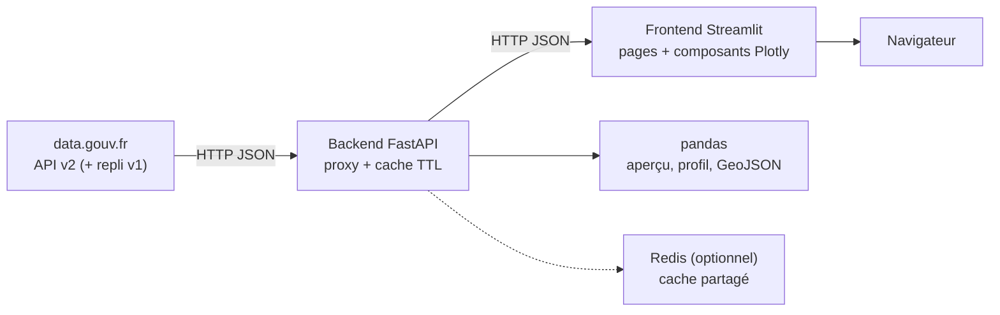

# 🇫🇷 DataFrance Explorer

Prototype d'explorateur des données publiques françaises : **backend FastAPI** qui
interroge l'API officielle [data.gouv.fr](https://www.data.gouv.fr) et **frontend
Streamlit** pour rechercher, prévisualiser et visualiser les jeux de données.

> Première ébauche fonctionnelle : la structure est volontairement modulaire pour
> être enrichie facilement (nouvelles pages, nouveaux endpoints, nouveaux graphiques).

---

## ✨ Fonctionnalités

- **Tableau de bord** : volumes globaux (jeux de données, organisations,
  réutilisations, services), répartition par famille de formats, type de
  producteur, licence et thématique.
- **Recherche en direct** : les résultats se mettent à jour pendant la frappe
  (composant `streamlit-searchbox`, suggestions + debounce) — pas besoin d'appuyer
  sur Entrée. Filtres famille de formats, producteur et licence, tri et pagination.
  L'API v2 plafonne l'affichage à 10 000 résultats, ce que l'interface signale.
- **Fiche jeu de données** : description, organisation, métriques, tags,
  ressources et liens officiels. Un lien **« Lire plus »** déplie le texte
  intégral des descriptions, dans les cartes comme dans les fiches.
- **Aperçu tabulaire** : lecture CSV / TSV / JSON / GeoJSON / Excel / Parquet,
  tableau interactif, export CSV. Les fichiers **Parquet pré-calculés par
  data.gouv.fr** sont utilisés en priorité.
- **Filtres locaux** : filtrer les lignes par plage numérique, période ou valeurs
  catégorielles, puis explorer les graphiques et corrélations sur le sous-ensemble.
- **Carte interactive** : onglet **🗺️ Carte** de la page *Visualiser*. Détection
  automatique des colonnes latitude/longitude, prise en charge des ressources
  **GeoJSON** (carte choroplèthe) et affichage sur fond OpenStreetMap.
  Un bouton de démonstration charge le jeu de données des gares ferroviaires.
- **Comparaison** : page **Comparer** pour rapprocher deux jeux de données —
  métadonnées, schémas, colonnes communes, distributions numériques et
  répartitions catégorielles.
- **Liens partageables** : la page *Visualiser* encode le jeu de données, le
  fichier et les filtres actifs dans l'URL, avec un lien prêt à copier.
- **Graphiques automatiques** : distributions numériques, répartitions
  catégorielles, séries temporelles, nuages de points, corrélations.
- **Profil statistique** : valeurs manquantes, unicité, min/moyenne/médiane/max,
  valeurs fréquentes.
- **Corrélations lisibles** : classement des paires les plus liées, matrice annotée,
  nuage de points avec droite de tendance, R² et interprétation en français.
- **Annuaire des organisations** avec leurs derniers jeux de données.
- **Cache Redis optionnel** et déploiement **Docker Compose** (Redis + API + UI).
- **Header / footer** et charte graphique commune (bleu Marianne).

---

## 🧱 Architecture



```
.
├── backend/
│   ├── app/
│   │   ├── main.py              # application FastAPI, CORS, erreurs, health
│   │   ├── config.py            # réglages (préfixe DFE_)
│   │   ├── schemas.py           # modèles Pydantic exposés
│   │   ├── api/
│   │   │   ├── deps.py
│   │   │   └── routes/
│   │   │       ├── search.py        # /api/search/*
│   │   │       ├── datasets.py      # /api/datasets/*
│   │   │       ├── organizations.py # /api/organizations/*
│   │   │       └── overview.py      # /api/stats/overview
│   │   └── services/
│   │       ├── datagouv.py      # client API, normalisation, facettes
│   │       ├── tabular.py       # lecture fichiers, aperçu, profil, GeoJSON
│   │       └── cache.py         # cache TTL mémoire ou Redis
│   ├── Dockerfile
│   ├── requirements.txt
│   └── .env.example
├── frontend/
│   ├── app.py                   # point d'entrée Streamlit + navigation
│   ├── api_client.py            # appels HTTP vers le backend
│   ├── navigation.py            # navigation différée entre pages
│   ├── url_state.py             # partage de vues par URL
│   ├── Dockerfile
│   ├── styles.py                # CSS / charte graphique
│   ├── components/
│   │   ├── header.py            # header, footer, statut API
│   │   ├── cards.py             # cartes dataset / organisation / KPI
│   │   ├── charts.py            # graphiques Plotly + auto-génération
│   │   └── formatting.py        # formats français (nombres, dates…)
│   ├── views/
│   │   ├── dashboard.py
│   │   ├── explore.py
│   │   ├── visualize.py
│   │   ├── compare.py
│   │   ├── organizations.py
│   │   └── about.py
│   ├── .streamlit/config.toml
│   └── requirements.txt
├── scripts/
│   ├── setup.ps1
│   ├── run_backend.ps1
│   ├── run_frontend.ps1
│   └── smoke_test.py
├── docker-compose.yml
├── requirements.txt
└── README.md
```

---

## 🚀 Démarrage rapide (Windows / PowerShell)

Python **3.11** est recommandé (roues binaires pandas / pyarrow disponibles).

```powershell
# 1. Environnement virtuel
py -3.11 -m venv .venv
.\.venv\Scripts\Activate.ps1

# 2. Dépendances
pip install -r backend\requirements.txt -r frontend\requirements.txt
```

### Terminal 1 — backend FastAPI

```powershell
cd backend
uvicorn app.main:app --reload --port 8000
```

- API : <http://127.0.0.1:8000>
- Documentation interactive : <http://127.0.0.1:8000/docs>

### Terminal 2 — frontend Streamlit

```powershell
cd frontend
$env:API_URL = "http://127.0.0.1:8000"   # optionnel, c'est la valeur par défaut
streamlit run app.py
```

- Application : <http://127.0.0.1:8501>

### Ou en une commande

```powershell
.\scripts\setup.ps1     # une seule fois
.\scripts\run_backend.ps1
.\scripts\run_frontend.ps1
```

> `start.ps1` peut aussi ouvrir les deux terminaux automatiquement.

### Vérifier le backend

```powershell
python scripts\smoke_test.py
```

Le script vérifie la santé du service, les statistiques, la recherche, le détail
d'un jeu de données, l'aperçu, le profil et les organisations.

---

## 🔌 Endpoints du backend

| Méthode | Route | Description |
|---|---|---|
| `GET` | `/api/health` | état du service (`?deep=true` pour tester data.gouv.fr) |
| `GET` | `/api/stats/overview` | totaux, facettes, derniers jeux de données |
| `GET` | `/api/search/datasets` | recherche (`q`, `page`, `page_size`, `sort`, filtres) |
| `GET` | `/api/search/organizations` | recherche d'organisations |
| `GET` | `/api/datasets/{id}` | fiche complète + ressources |
| `GET` | `/api/datasets/{id}/preview` | aperçu d'une ressource (`resource_id`, `limit`) |
| `GET` | `/api/datasets/{id}/profile` | profil statistique (`resource_id`, `limit`) |
| `GET` | `/api/datasets/{id}/geo` | FeatureCollection GeoJSON allégée pour la carte (`resource_id`, `limit`) |
| `GET` | `/api/organizations/{id}` | fiche organisation + derniers datasets |

Exemples :

```bash
curl "http://127.0.0.1:8000/api/search/datasets?q=transport&page_size=5"
curl "http://127.0.0.1:8000/api/datasets/6aec4a5e2f9ad56a51d37e7c/resources"  # via /api/datasets/{id}
curl "http://127.0.0.1:8000/api/datasets/6aec4a5e2f9ad56a51d37e7c/preview?limit=20"
```

---

## ⚙️ Configuration

Copiez `backend/.env.example` vers `backend/.env` et ajustez si besoin.

| Variable | Défaut | Rôle |
|---|---|---|
| `DFE_DATAGOUV_API_BASE` | `https://www.data.gouv.fr/api` | base de l'API amont |
| `DFE_CACHE_TTL` | `300` | durée du cache (secondes) |
| `DFE_REDIS_URL` | *(vide)* | cache Redis partagé, ex. `redis://127.0.0.1:6379/0` |
| `DFE_MAX_DOWNLOAD_MB` | `25` | taille max d'un fichier téléchargé |
| `DFE_MAX_PARQUET_DOWNLOAD_MB` | `60` | taille max d'un Parquet |
| `DFE_MAX_GEOJSON_DOWNLOAD_MB` | `100` | taille max d'un GeoJSON |
| `DFE_PROFILE_ROWS` | `20000` | lignes max analysées pour le profil |
| `DFE_CORS_ORIGINS` | `*` | origines autorisées (liste séparée par virgules) |
| `API_URL` (frontend) | `http://127.0.0.1:8000` | URL du backend |

---

## 🐳 Déploiement Docker (avec Redis)

Le fichier `docker-compose.yml` lance trois services : **Redis**, le **backend**
FastAPI et le **frontend** Streamlit.

```powershell
# Construire et démarrer
docker compose up --build

# En arrière-plan
docker compose up --build -d

# Arrêter
docker compose down
```

- Interface : <http://localhost:8501>
- API : <http://localhost:8000/docs>
- Le backend utilise automatiquement `DFE_REDIS_URL=redis://redis:6379/0`.
- Sans Redis, le backend retombe sur son cache mémoire (aucune configuration requise).

---

## 🧩 Personnaliser le template

### Ajouter une page

1. Créer `frontend/views/ma_page.py` avec une fonction `render()`.
2. L'importer et l'ajouter au dictionnaire `PAGES` dans `frontend/app.py`.

Les pages peuvent lire/écrire l'URL via `frontend/url_state.py` pour partager
un état de vue (dataset, fichier, filtres).

```python
# frontend/views/ma_page.py
import streamlit as st

def render() -> None:
    st.markdown("## Ma nouvelle page")
    st.write("Contenu…")
```

```python
# frontend/app.py
from views import ma_page

PAGES = {
    "Tableau de bord": dashboard.render,
    "Explorer les données": explore.render,
    "Visualiser": visualize.render,
    "Organisations": organizations.render,
    "À propos": about.render,
    "Ma page": ma_page.render,
}
```

### Ajouter un composant

Les composants vivent dans `frontend/components/` et réutilisent les classes CSS
`dfe-*` définies dans `frontend/styles.py` (`dfe-card`, `dfe-pill`, `dfe-kpi`…).

### Ajouter un endpoint

1. Modèle Pydantic dans `backend/app/schemas.py`.
2. Routeur dans `backend/app/api/routes/`.
3. Inclusion dans `backend/app/main.py` avec `prefix="/api"`.

---

## ⚠️ Limites de cette première version

- Fichiers limités à **25 Mo** (60 Mo pour les Parquet, **100 Mo pour les GeoJSON**)
  et **20 000 lignes** pour le profil. Les gros fichiers texte (CSV/JSON) sont lus
  partiellement ; un GeoJSON est toujours téléchargé en entier pour rester valide.
- Recherche plafonnée à **10 000 résultats** par l'API v2 de data.gouv.fr.
- Formats supportés : CSV/TSV, JSON/GeoJSON/NDJSON, Excel, Parquet. Pas encore de ZIP, XML complexe ou SQL.
- Cache **en mémoire par défaut** ; Redis est optionnel (perte du cache au redémarrage
  sans Redis).
- Cartes GeoJSON limitées aux **800 premières géométries** (paramètre `limit` de l'API).
- Graphiques automatiques simples ; les filtres locaux portent sur les lignes
  chargées dans le navigateur, pas sur le fichier complet.
- Export **CSV** des lignes filtrées et **PNG** via la barre d'outils Plotly.
  Pas encore d'export PDF ou HTML natif.
- Interface non officielle ; les données restent soumises aux licences de chaque producteur.

## 🔭 Pistes pour la suite

- Authentification et favoris (comptes utilisateurs).
- Export PDF natif et génération d'un rapport de comparaison.
- Reverse proxy TLS (Caddy / Nginx) et monitoring.
- Jointures entre deux jeux de données sur une clé commune.
- Cache des DataFrames dans Redis (nécessite une sérialisation dédiée).

---

## 📄 Licence & crédits

- Données : [data.gouv.fr](https://www.data.gouv.fr) et ses producteurs.
- Code : prototype pédagogique, à adapter librement.
